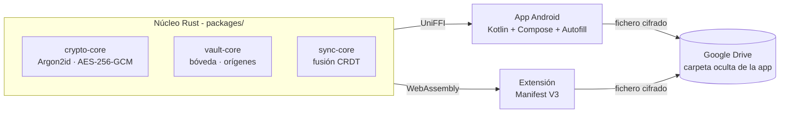

# Keyvora

[](https://github.com/nbch0203/Keyvora/actions/workflows/ci.yml)
[](https://github.com/nbch0203/Keyvora/releases/latest)

Gestor de contraseñas **local-first**: recuerdas una sola contraseña maestra y Keyvora guarda en una bóveda cifrada
una contraseña aleatoria y distinta para cada servicio. Funciona en **Android** (con autorrelleno) y como **extensión
de navegador** (Chrome, Edge, Brave y Firefox), y puede sincronizar la bóveda entre dispositivos a través de **Google
Drive**, que solo recibe el fichero cifrado.

## Características

- **Cifrado en tu dispositivo**: la contraseña maestra nunca se guarda ni se envía; nadie más puede leer la bóveda.
- **Generador** de contraseñas seguras y comprobación de la fortaleza de la contraseña maestra.
- **Autorrelleno** en Android y en el navegador, solo en el sitio o la app correctos (protección contra phishing).
- **Sincronización** opcional con Google Drive sin perder cambios hechos sin conexión en varios dispositivos.
- **Clave de recuperación** por si olvidas la contraseña maestra, y **biometría** opcional en Android.
- **Copia cifrada** exportable e importable.

## Arquitectura

Toda la lógica sensible (criptografía, formato de la bóveda, fusión de cambios y comprobación de orígenes) vive en un
único **núcleo en Rust**. Android y la extensión lo usan tal cual a través de sus *bindings*, así que no hay dos
implementaciones que puedan divergir.



**Cómo se protege la bóveda:** la contraseña maestra pasa por Argon2id (64 MiB) para obtener una clave que envuelve
una clave de datos aleatoria; esa clave cifra la bóveda con AES-256-GCM, que también autentica la cabecera. Drive
solo almacena ese contenedor cifrado en la carpeta oculta de la app (`drive.appdata`). La clave de recuperación es
independiente, de 256 bits, y se muestra una sola vez.

```text
packages/
  crypto-core/          Primitivas criptográficas (RustCrypto)
  password-generator/   Generador de contraseñas sin sesgo
  vault-core/           Formato de la bóveda, claves, recuperación, coincidencia de orígenes
  sync-core/            Fusión de cambios entre dispositivos sin pérdida
  bindings-wasm/        API del núcleo para la extensión (WebAssembly)
  bindings-uniffi/      API del núcleo para Android (Kotlin, UniFFI)
  shared-models/        Tipos compartidos y vectores de prueba
apps/
  android/              App Android
  browser-extension/    Extensión de navegador
scripts/                Entorno y compilación (Windows / WSL)
tests/security/         Verificación independiente del formato (Python)
```

## Instalación

Descarga los ficheros de la [última versión](https://github.com/nbch0203/Keyvora/releases/latest). Puedes comprobar
que no se han alterado con `SHA256SUMS.txt` (las notas de cada versión incluyen la huella del certificado de la APK).

**Android** (8.0 o superior)
1. Descarga `keyvora-X.Y.Z.apk` en el móvil y ábrela (permite instalar apps de origen desconocido si te lo pide).
2. Abre Keyvora y crea tu bóveda; guarda la clave de recuperación fuera del móvil.
3. Activa el autorrelleno: *Ajustes del sistema → Contraseñas y cuentas → Servicio de autocompletar → Keyvora*.

**Chrome, Edge o Brave**
1. Descarga y descomprime `keyvora-extension-chromium-X.Y.Z.zip`.
2. Abre `chrome://extensions`, activa el *Modo de desarrollador* y pulsa *Cargar descomprimida* sobre la carpeta.

**Firefox**: el zip aún no está firmado por Mozilla, así que solo se puede cargar como complemento temporal desde
`about:debugging` → *Este Firefox* → *Cargar complemento temporal*.

**Sincronizar con Google Drive**: en *Ajustes* de la app o de la extensión conecta Google Drive y elige tu cuenta.
Usa la misma bóveda en todos tus dispositivos: créala en uno y, en los demás, restáurala desde Google Drive al
empezar en lugar de crear otra.

## Compilar desde el código

Requisitos: Rust (stable), Node.js 22.18+, JDK 17 y Android SDK 35. En Windows se usa Git Bash para los scripts y WSL
para compilar el núcleo (ver [`scripts/`](scripts/)).

```bash
source scripts/env.sh                              # rutas de las herramientas
scripts/wsl.sh scripts/wsl/test-core.sh            # núcleo: formato, clippy, tests y vectores
scripts/wsl.sh scripts/wsl/build-wasm.sh           # núcleo → WebAssembly para la extensión
scripts/wsl.sh scripts/wsl/build-android-core.sh   # núcleo → librerías y bindings para Android
```

Después, cada cliente tiene su guía:
- Extensión: [`apps/browser-extension/README.md`](apps/browser-extension/README.md) (`npm ci && npm run build`).
- Android: [`apps/android/README.md`](apps/android/README.md) (`./gradlew :app:assembleDebug`; para una versión de
  uso real, «Compilar para uso real» con tu propia clave de firma).

Cada cambio en `main` pasa por el [CI](.github/workflows/ci.yml): núcleo, extensión (tests unitarios y E2E) y Android.

## Publicar una versión

1. CI en verde, `cargo audit` limpio y la sección `## [X.Y.Z]` en [`CHANGELOG.md`](CHANGELOG.md); la versión debe
   coincidir en la extensión (`package.json`, `manifest.json`) y en Android (`versionName`).
2. `git tag -a vX.Y.Z -m "Keyvora X.Y.Z" && git push origin vX.Y.Z`: el workflow
   [`release`](.github/workflows/release.yml) compila la extensión y crea un **borrador** con los zips y los hashes.
3. Compila la APK firmada en local (la clave nunca va al CI), adjúntala al borrador con su hash y publícalo.

## Estado

Versión **0.1.0**, la primera publicada. El código ha pasado una auditoría de seguridad interna, pero no una
auditoría externa independiente: haz copias cifradas de tu bóveda y guarda tu clave de recuperación.
